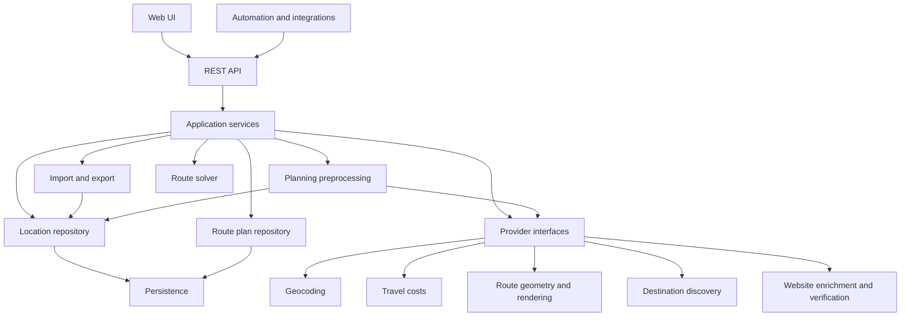

# Tourguide architecture

## Purpose and principles

Tourguide is a locally deployable Web application for discovering, maintaining, sharing and visiting destinations. It calculates itineraries from geographic, temporal and visit constraints using interchangeable providers.

- The Web UI is the primary product interface; the REST API supports automation and integrations.
- Keep application logic independent of HTTP, presentation, storage and external providers.
- Prefer local operation without mandatory commercial APIs.
- Deliver a usable Web product early and extend it incrementally.
- Preserve user control over imported and externally discovered data.

## Existing baseline and transition

The existing Python application reads YAML configuration and waypoint definitions, expands opening hours into dated time windows, uses OR-Tools for optimization and provides interchangeable geocoding, travel cost and rendering backends. Docker supports local OSRM routing; `./download-osm.sh` downloads the Switzerland OSM extract. Correctness and integration coverage still need review.

Keep the existing CLI working during the foundational work as a temporary execution entry point. Do not develop new CLI-specific features. Retire it once its existing workflows are covered by the Web UI. Retain infrastructure and administration scripts.

## Target architecture

This diagram describes the intended architecture, not the current implementation. Components are introduced as needed by the roadmap.

Extract application services incrementally. The proposed initial stack is FastAPI, plain HTML/CSS/JavaScript, Leaflet and Docker Compose. Use configurable map tiles with appropriate attribution and usage compliance. Keep provider credentials on the server.

## Data and persistence

Separate application configuration, reusable destination records and individual route plans. Use repository interfaces to isolate internal storage from application logic and exchange formats.

A destination has a stable ID and identifying information such as a name, address or coordinates. Other attributes may include website, recurring opening hours, exceptions, tags, provider identifiers and field provenance. Incomplete but identifiable records are valid for storage; planning requires a resolvable location and sufficient availability information, including explicit visit overrides where necessary. Unknown opening hours must not silently mean always open.

A route plan references stored destinations or inline locations and specifies visit durations, priorities, overrides, start/end locations and temporal constraints. Keep visit-specific settings separate from reusable destination attributes.

YAML is the initial persistence option, not a permanent requirement. Evaluate transactional storage such as SQLite when shared editing requires it. YAML and CSV remain exchange formats independently of storage. Preserve stable identifiers and avoid lost updates when changing persistence.

## Planning and optimization

- For a fixed-date trip, start and end use absolute datetime windows. Date-range planning instead defines candidate dates and daily constraints, from which concrete windows are derived. Expand recurring opening hours into dated windows before solving, with explicit timezone semantics, multiple intervals, special recurring hours, date-specific exceptions and clipping to the planning horizon.
- Distinguish arrival, service start and departure. Enforce completion before closing where required.
- Normalize solver inputs into indexed nodes, integer travel costs, service durations and time windows. Enforce exactly one feasible window for each mandatory visit. A mandatory visit without a feasible window makes the requested plan infeasible; optional visits may be skipped according to their configured priorities. Alternative destinations are a separate future constraint.
- Return structured results including visit order, schedule, waiting, service and travel times, distance where available, skipped visits and optimization status. Distinguish infeasibility, timeout without a solution, feasible results without proven optimality and provider failures.
- Use a canonical coordinate representation; convert to provider-specific ordering at boundaries. Unreachable travel legs must not be interpreted as zero-cost connections. Cache geocoding and travel costs using provider/profile-aware keys and departure time where relevant.
- Support single-day planning first, then best-day selection within a date range, independent day trips, and finally continuous multi-day trips with overnight stays. Keep these modes distinct.

## Destination discovery

Expose a separate provider interface for search terms and geographic areas. Initially support bounding boxes, radii and the visible map viewport; later add polygons and administrative regions. Return candidates with available names, addresses, coordinates, opening hours, websites, provider identifiers and provenance.

Potential providers include Google Places, Overpass and a separately indexed local OSM extract. OSRM is a routing service, not a discovery index. Respect provider terms, storage restrictions, attribution, rate limits and result caps. Report coverage limitations and missing fields; do not promise exhaustive results. Support pagination or geographic subdivision where permitted and useful; deduplicate overlapping results and distinguish completed searches from partial or failed searches. Review candidates through the common import service before persistence.

## Destination import and export

Use one source-independent import workflow for uploaded files, pasted structured text, manually collected records and discovery candidates. Initially support YAML and CSV; later consider JSON and extraction from unstructured chats or emails.

Separate parsing, normalization, validation, duplicate detection, review and persistence. Accept incomplete identifiable records. Distinguish new records, identical duplicates, missing-field supplements, potential duplicates, conflicting values and invalid records. Allow selective approval, record-level errors and partial success for unrelated valid records. Never silently overwrite existing values. Revalidate conflicts at commit time when shared editing is supported.

Export individual destinations, selected groups or the entire repository. YAML must support lossless round trips of exportable data, including nested opening hours, exceptions and provenance. Document CSV mappings and limitations. Respect source-specific export restrictions and report excluded data. Provide service support first, then Web upload, pasted input, review and downloads. Use safe parsing, bounded uploads and spreadsheet-safe CSV handling.

## Website enrichment and verification

Use optional destination websites to enrich missing fields and verify existing values. Start with structured metadata (e.g. JSON-LD) and relevant contact/opening-hours pages; later consider complex HTML, PDFs and LLM-assisted extraction.

Return field-level proposals with source URLs, retrieval dates and uncertainty. Distinguish unavailable sources from confirmed closure. Require review before updating stored data. Treat retrieved content as untrusted, respect site policies and limit requests. Protect server-side fetching against private-network access, unsafe redirects and unbounded responses.

## Web UI and collaboration

The first usable Web product must support destination management and import/export, route definition, calculation, itinerary and map display. Show the actual calculated geometry where available and distinguish externally recalculated routes. Expose useful validation errors and limitations rather than hiding incomplete functionality.

Plan for a shared destination repository, concurrent editing, personal and shared route plans, contributor identity, access control, change history and import provenance. Full collaboration features can evolve after the first UI. The initial deployment may be single-user in a trusted environment. Before enabling shared access, establish appropriate authentication, authorization, data integrity and deployment protections. Avoid concurrent writes that can silently lose changes.

## Quality and operations

Maintain unit tests for domain logic and solver constraints, mocked provider tests and optional live integration tests. Add API and UI workflow tests as those interfaces arrive. Keep credentials and private data out of Git. Preserve planning inputs and results where provider terms permit; record relevant provider and solver settings. Recalculation may differ when external data or solver behavior changes. Document deployment, backup and recovery as persistence evolves. Use structured diagnostics and explicit errors.

## Open decisions

Exact schemas (including import identity matching and CSV mappings), timezone and exception rules, explicit unknown-hours overrides, optimization objectives, discovery providers, persistence/concurrency implementation, authentication and frontend details remain to be settled in their respective PRs. See [ROADMAP.md](ROADMAP.md) for sequencing and milestones.
