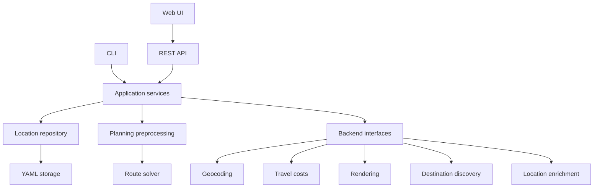

# Tourguide architecture

## Purpose

Tourguide is a locally deployable itinerary planner for reusable destinations, availability constraints and interchangeable routing services. The CLI and an early Web UI should use the same application logic.

## Current baseline

The Python application uses YAML configuration and waypoint input, OR-Tools for route optimization, and interchangeable geocoding, cost and rendering backends. Opening hours are expanded into date-specific time windows before solving. The Docker setup supports local OSRM routing; the Switzerland OSM extract can be downloaded with `./download-osm.sh`. This baseline is not a claim that all constraints or integrations have been fully tested.

## Target architecture

Keep domain logic independent of HTTP, CLI, persistence and external providers. Extract application services incrementally rather than rewriting the existing application. Proposed initial Web stack: FastAPI, plain HTML/CSS/JavaScript, Leaflet, and Docker Compose. Keep the CLI functional. Use a configurable map tile provider with appropriate attribution and usage compliance.

## Data and planning

- Keep application configuration, reusable location data and individual route definitions separate.
- A reusable location has a stable ID, name, address, optional coordinates, website, recurring opening hours, exceptions, tags and provenance.
- A route references locations or defines inline destinations; visit duration, priority and overrides belong to the planning request.
- Start and end retain absolute datetime time windows. Expand recurring opening hours for the relevant planning dates before solving, using explicit local timezone semantics and clipping to the planning horizon. Handle closed days, multiple intervals, exceptional dates and visits that must finish before closing.
- Normalize solver inputs into indexed nodes, integer travel costs, service durations and time windows. Alternative windows for one mandatory visit must enforce exactly one visit. Keep optional visits explicitly distinct.
- Return structured results with visit order, arrival/departure times, waiting, service, travel duration, distance where available, and skipped visits. Distinguish infeasibility from timeouts and provider errors.
- Use a canonical coordinate representation and convert to provider-specific ordering at backend boundaries. Cache geocoding and travel costs with provider/profile-aware keys.

## Destination discovery

Provide a separate discovery interface accepting a search term and geographic area. Initial area types are bounding box and radius; later support polygons and administrative regions. The Web UI can use the visible map bounds. Candidate results may include name, address, coordinates, opening hours, website, provider identifiers and provenance. Review and deduplicate candidates before importing them into the location repository.

Potential providers include Google Places, Overpass and a separately indexed local OSM extract. OSRM is a routing service, not a discovery index. Respect provider terms, attribution, storage restrictions, rate limits and result caps. Report incomplete coverage and missing fields rather than claiming exhaustive results. Provider selection and indexing design remain open.

## Website enrichment and verification

An optional website on a location is an input to enrichment (missing fields) and verification (existing fields). A dedicated backend may extract structured metadata such as JSON-LD, then relevant contact/opening-hours pages. More complex HTML, PDFs or LLM-assisted interpretation can follow. Return field-level proposed changes with source URLs, retrieval dates and uncertainty; never silently overwrite maintained records. Distinguish unreachable sources from confirmed closure. Limit requests, respect site policies, and protect server-side fetching against private-network access, unsafe redirects and unbounded responses. Treat retrieved content as untrusted data.

## Deployment and quality

Prefer local operation without mandatory commercial APIs. Keep credentials and private data out of Git. Maintain unit tests for domain logic and solver constraints, mocked provider tests and optional live integration tests. Keep UI usable while features are incomplete, with clear errors and limitations. Add features vertically across application, API and UI once the initial Web product exists.

## Open decisions

Exact location schema, timezone/exception rules, optimization objectives, persistence concurrency, discovery provider choice, and frontend details will be settled in their respective PRs. YAML is the initial storage proposal, not a permanent restriction.
